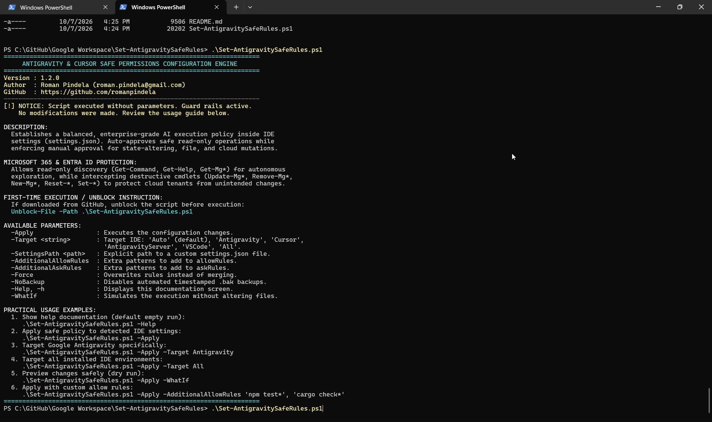
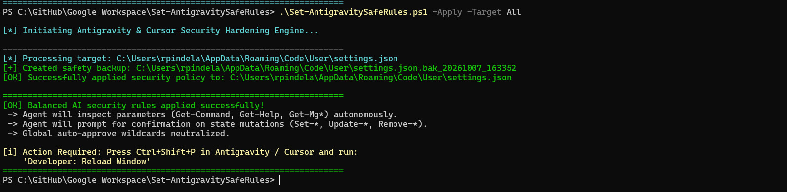

# Antigravity & Cursor Permissions Configuration Engine

An enterprise-grade PowerShell automation script engineered to establish, configure, and maintain dual-mode AI agent execution policies inside Google Antigravity, Cursor, and VS Code configuration files (`settings.json`).

The engine supports two distinct operational modes:
* **Safe Mode (`-Mode Safe` / `-Safe`):** Enforces human verification for all write, modify, delete, and cloud-mutating operations while granting autonomous execution for harmless inspection and discovery.
* **Full Machine Mode (`-Mode FullMachine` / `-FullMachine`):** Grants complete, unrestricted machine autonomy with zero confirmation prompts to the user. The AI agent executes commands, creates files, and modifies project state without interruption.

---

## Metadata & Ownership

* **Author:** Roman Pindela
* **Contact Email:** [roman.pindela@gmail.com](mailto:roman.pindela@gmail.com)
* **GitHub Profile:** [https://github.com/romanpindela](https://github.com/romanpindela)
* **Current Version:** `1.3.0`
* **Release Date:** October 2026
* **License:** MIT

---

## Visual Previews & Screenshots

| Default Guard Rails & Help Screen (`.\Set-AntigravitySafeRules.ps1`) |
| :---: |
|  |

| Applying Security Rules to Targets (`.\Set-AntigravitySafeRules.ps1 -Apply -Target All`) |
| :---: |
|  |

---

## Dual Operational Modes

### 1. Safe Mode (`-Mode Safe` or `-Safe`)
Applies the **Principle of Least Privilege** for development safety:
* **Autonomous Read-Only Discovery:** Auto-approves harmless parameter inspection, command help, and Git read commands (`Get-Command`, `Get-Help`, `Get-Member`, `Get-Mg*`, `git status/log/diff`), allowing AI agents to navigate the environment without unnecessary friction.
* **Guarded Write, Modification & State Changes:** Enforces explicit user confirmation before executing state-altering, file-system mutating, or cloud operations (`Set-*`, `Update-*`, `Remove-*`, `New-*`, `Out-File`, `Set-Content`, `git commit/push/reset`, M365/Entra ID mutations).
* **Hardened Execution Flags:** Sets `agent.permissions.mode = "request-review"`, `agent.terminal.alwaysProceed = false`, `agent.artifactReviewPolicy = "asks-for-review"`, and `agent.fileAccess.policy = "ask"`. Neutralizes hazardous wildcard auto-approvals.

### 2. Full Machine Mode (`-Mode FullMachine` or `-FullMachine`)
Designed for autonomous pipelines, automated testing, containerized workspaces, and trusted developer environments:
* **Zero Prompting:** The agent executes commands and modifies the environment without prompting the user.
* **Full Unrestricted Permissions:** Grants universal wildcard permissions (`agent.permissions.allowRules = ["*"]`) and completely clears interactive confirmation rules (`agent.permissions.askRules = []`).
* **Autonomous Execution Flags:** Enforces `agent.permissions.mode = "always-proceed"`, `agent.terminal.alwaysProceed = true`, `agent.autoApproveExecution = true`, `agent.artifactReviewPolicy = "always-proceed"`, and `agent.fileAccess.policy = "allow"`.

---

## Architectural Highlights

* **Non-Interactive & Parameter-Driven:** Operates completely unattended without requiring interactive keyboard inputs or blocking confirmation dialogs.
* **Multi-Runtime JSON Engine:** Seamlessly handles both Windows PowerShell 5.1 and modern PowerShell Core 7+. Uses recursive object mapping and safely strips VS Code JSON with Comments (`JSONC`), preventing parse failures or configuration loss.
* **Deterministic Guard Rails:** Running the script without parameters (`.\Set-AntigravitySafeRules.ps1`) triggers an empty-run protection banner with usage guidance and exits safely without altering settings.
* **Bilingual Windows Compatibility:** Built with language-independent .NET APIs (e.g., WellKnownSidType `BuiltInAdministratorsSid`, `[System.Environment]::GetFolderPath('ApplicationData')`), ensuring identical operation on Polish ("Administratorzy") and English ("Administrators") editions of Windows Desktop and Windows Server.
* **Automatic Safety Backups:** Automatically generates timestamped backups (e.g., `settings.json.bak_20261009_061046`) before modifying any configuration file.
* **Simulation Support (WhatIf):** Full support for PowerShell `-WhatIf` and `-Confirm` flags (`[CmdletBinding(SupportsShouldProcess = $true)]`) for zero-risk dry-run audits.
* **Preservation of Existing Settings:** Merges permission rules into existing user configurations without overwriting unrelated IDE preferences, theme selections, or extension configs.

---

## Microsoft 365 & Entra ID Protection (Safe Mode)

When interacting with Microsoft 365 (Exchange Online, SharePoint Online, Teams) or Azure / Entra ID via Microsoft Graph PowerShell (`Microsoft.Graph`), AI coding assistants can accidentally execute destructive tenant commands if auto-approve rules are overly broad.

Under **Safe Mode**, granular boundaries are enforced:
* **Allowed (Autonomous):** Read-only introspection cmdlets such as `Get-Command`, `Get-Help`, `Get-MgUser`, `Get-MgGroup`, and `Get-MgServicePrincipal`. The AI agent can examine schemas, query IDs, and retrieve tenant state without user prompts.
* **Guarded (Interactive Approval):** Destructive or mutating cmdlets such as `Update-MgUser`, `Remove-MgUser`, `New-MgGroup`, `Reset-MgUserPassword`, and `Set-Mailbox` are intercepted. The IDE requires explicit human confirmation before commands execute.

---

## Prerequisites & Installation

### 1. PowerShell Execution Policy
Ensure your PowerShell execution policy allows running local scripts:
```powershell
Set-ExecutionPolicy -ExecutionPolicy RemoteSigned -Scope CurrentUser
```

### 2. Unblocking the Script (Important)
When downloading PowerShell scripts from GitHub or the Internet, Windows attaches an alternate data stream (`Zone.Identifier`) that marks the file as untrusted. Unblock the script before running:
```powershell
Unblock-File -Path .\Set-AntigravitySafeRules.ps1
```

### 3. Administrator Privileges Note
By design, user-level IDE configuration files reside inside `%APPDATA%` (`$HOME\AppData\Roaming\Antigravity\User\settings.json`). Modifying these files does **not** require elevation. Running this script as Administrator is unnecessary and discouraged because elevation shifts `%APPDATA%` to the Administrator profile rather than your user environment.

---

## Parameter Reference

| Parameter | Type | Default | Description |
| :--- | :--- | :--- | :--- |
| `-Mode` | `[string]` | `'Safe'` | Operational mode: `'Safe'` (approval required for mutations) or `'FullMachine'` (full autonomy, no prompts). |
| `-FullMachine` | `[switch]` | `$false` | Convenience switch to directly apply Full Machine mode with zero prompts. |
| `-Safe` | `[switch]` | `$false` | Convenience switch to directly apply Safe mode with mutation guardrails. |
| `-Apply` | `[switch]` | `$false` | Executes configuration updates on targeted settings files. |
| `-Target` | `[string]` | `'Auto'` | Target IDE profile: `Auto` (default), `Antigravity`, `Cursor`, `AntigravityServer`, `VSCode`, `All`. |
| `-SettingsPath` | `[string]` | *Auto-detected* | Explicit file path to a custom `settings.json` file. |
| `-AdditionalAllowRules` | `[string[]]` | `@()` | Additional command patterns to append to `agent.permissions.allowRules`. |
| `-AdditionalAskRules` | `[string[]]` | `@()` | Additional command patterns to append to `agent.permissions.askRules`. |
| `-Force` | `[switch]` | `$false` | Overwrites permission rules rather than merging with existing custom rules. |
| `-NoBackup` | `[switch]` | `$false` | Suppresses creation of `.bak_yyyyMMdd_HHmmss` backup files. |
| `-Help`, `-h` | `[switch]` | `$false` | Displays the interactive CLI help banner, author details, and syntax. |
| `-WhatIf` | `[switch]` | N/A | Simulates configuration changes without modifying files (dry run). |
| `-Confirm` | `[switch]` | N/A | Prompts for confirmation before modifying each target file. |

---

## Policy Settings Comparison

| Setting Key | Safe Mode (`-Safe`) | Full Machine Mode (`-FullMachine`) |
| :--- | :--- | :--- |
| `agent.permissions.mode` | `"request-review"` | `"always-proceed"` |
| `agent.terminal.alwaysProceed` | `false` | `true` |
| `agent.autoApproveExecution` | *Removed / `false`* | `true` |
| `agent.artifactReviewPolicy` | `"asks-for-review"` | `"always-proceed"` |
| `agent.fileAccess.policy` | `"ask"` | `"allow"` |
| `agent.permissions.allowRules` | Read-only inspection patterns | `["*"]` (Wildcard allow-all) |
| `agent.permissions.askRules` | Write, modify & mutation patterns | `[]` (Empty, zero prompts) |
| `antigravity.terminal.autoApprove` | `false` | `true` |

---

## Policy Rules Breakdown (Safe Mode)

### Default Allow Rules (`agent.permissions.allowRules`)
Harmless discovery and inspection commands that execute without prompts:
* `*Get-Command*`
* `*Get-Help*`
* `*Get-Member*`
* `*Parameters.Keys*`
* `*ParameterSets*`
* `powershell *-Command *Get-*`
* `pwsh *-Command *Get-*`
* `*Get-Mg*`
* `*Get-Az*`
* `git status*`
* `git log*`
* `git diff*`
* `git show*`
* `git branch`
* `git branch -a`
* `git branch -r`

### Default Ask Rules (`agent.permissions.askRules`)
Operations requiring interactive human confirmation:
* State mutations: `*Update-*`, `*Set-*`, `*Remove-*`, `*New-*`, `*Reset-*`, `*Clear-*`, `*Restart-*`, `*Stop-*`
* File writes & edits: `*Out-File*`, `*Set-Content*`, `*Add-Content*`, `*New-Item*`, `*Remove-Item*`, `*Move-Item*`, `*Rename-Item*`, `*Copy-Item*`, `*rm *`, `*rmdir*`, `*del *`, `*erase *`
* Process & network: `*Start-Process*`, `*Stop-Process*`, `*Invoke-RestMethod*`, `*Invoke-WebRequest*`
* Git state changes: `git push*`, `git reset*`, `git checkout*`, `git commit*`, `git merge*`, `git rebase*`, `git clean*`, `git branch -D*`, `git branch -d*`
* Cloud mutations: `*Update-Mg*`, `*Remove-Mg*`, `*New-Mg*`, `*Reset-Mg*`, `*Set-Mg*`, `*Set-Az*`, `*New-Az*`, `*Remove-Az*`, `*Update-Az*`

---

## Usage Scenarios & Examples

### 1. Safe Inspection & Help Banner (Default Empty Run)
Running the script without parameters displays the built-in help guide and exits safely:
```powershell
.\Set-AntigravitySafeRules.ps1
# or explicitly:
.\Set-AntigravitySafeRules.ps1 -Help
```

### 2. Apply Safe Mode (Interactive Approval for Writes & Changes)
Auto-detects active IDE configurations and applies the guarded safe policy:
```powershell
.\Set-AntigravitySafeRules.ps1 -Safe
# or using explicit syntax:
.\Set-AntigravitySafeRules.ps1 -Apply -Mode Safe
```

### 3. Apply Full Machine Mode (Full Permissions, Zero Prompts)
Configures completely autonomous execution without user prompts:
```powershell
.\Set-AntigravitySafeRules.ps1 -FullMachine
# or using explicit syntax:
.\Set-AntigravitySafeRules.ps1 -Apply -Mode FullMachine
```

### 4. Target Google Antigravity Explicitly
Directs configuration strictly to Google Antigravity User settings:
```powershell
.\Set-AntigravitySafeRules.ps1 -Target Antigravity -Safe
# or in Full Machine mode:
.\Set-AntigravitySafeRules.ps1 -Target Antigravity -FullMachine
```

### 5. Target All Installed IDE Environments
Audits and updates every discovered editor installation across the workstation:
```powershell
.\Set-AntigravitySafeRules.ps1 -Target All -Safe
# or in Full Machine mode:
.\Set-AntigravitySafeRules.ps1 -Target All -FullMachine
```

### 6. Dry-Run / Simulation Mode (`-WhatIf`)
Audits what files would be modified and where backups would be generated without writing to disk:
```powershell
.\Set-AntigravitySafeRules.ps1 -FullMachine -WhatIf
```

### 7. Appending Custom Project Rules (Safe Mode)
Adds project-specific test and build commands to the auto-approve allow list:
```powershell
.\Set-AntigravitySafeRules.ps1 -Safe -AdditionalAllowRules "npm test*", "cargo check*", "pytest*"
```

### 8. Custom File Path
Applies the policy to a non-standard or portable editor path:
```powershell
.\Set-AntigravitySafeRules.ps1 -SettingsPath "D:\PortableApps\Antigravity\data\user-data\User\settings.json" -FullMachine
```

### 9. Force Resetting Permission Lists
Overwrites existing permission rules with the clean baseline, discarding legacy or stale entries:
```powershell
.\Set-AntigravitySafeRules.ps1 -Safe -Force
```

---

## Post-Execution Activation

After applying the configuration, reload the IDE window to apply updated settings immediately:
1. In Antigravity, Cursor, or VS Code, press **`Ctrl + Shift + P`** (or **`Cmd + Shift + P`** on macOS).
2. Type and select: **`Developer: Reload Window`**.

---

## Version History & Changelog

### Version 1.3.0 (October 2026)
* **Dual Operational Modes:** Added first-class support for `-Mode Safe` and `-Mode FullMachine` along with dedicated `-Safe` and `-FullMachine` switches.
* **Full Machine Autonomy:** Implemented full unrestricted machine mode with zero user prompts (`always-proceed`, `alwaysProceed = true`, `autoApproveExecution = true`, allowRules `["*"]`, cleared askRules `[]`).
* **Safe Mode Reinforcement:** Added comprehensive guardrails for write (`Out-File`, `Set-Content`, `Add-Content`, `New-Item`), modification, deletion, process control, and cloud mutations while stripping hazardous wildcard `*` from allow lists.
* **Non-Interactive Execution:** Ensured completely unattended execution driven by parameters without prompting the user.
* **JSON Array Serialization:** Fixed serialization of empty rule lists to ensure `askRules` correctly outputs as a clean JSON array `[]` in Full Machine mode.

### Version 1.2.0 (October 2026)
* **Bug Fix:** Removed invalid LaTeX syntax (`\vert{}`) and corrected string quote parsing errors in `Set-AntigravitySafeRules.ps1`.
* **CleanCode Architecture:** Modularized code with robust helper functions (`Show-ScriptHelp`, `Get-TargetSettingsPaths`, `Convert-JsonToOrderedDictionary`, `Sanitize-Rules`).
* **Guard Rails:** Implemented default empty-run protection requiring explicit execution switches to modify files.
* **PowerShell 5.1 & 7 Compatibility:** Implemented custom recursive JSON deserializer supporting both Windows PowerShell 5.1 and modern PowerShell Core 7+.
* **JSONC Support:** Added automatic regex stripping for single-line (`//`) and multi-line (`/* */`) comments in `settings.json`.
* **Cloud & M365 Security:** Added `*Get-Mg*` discovery to default allow rules while strictly gating mutating cmdlets.
* **Documentation:** Created comprehensive enterprise `README.md` with complete parameter and usage reference.
